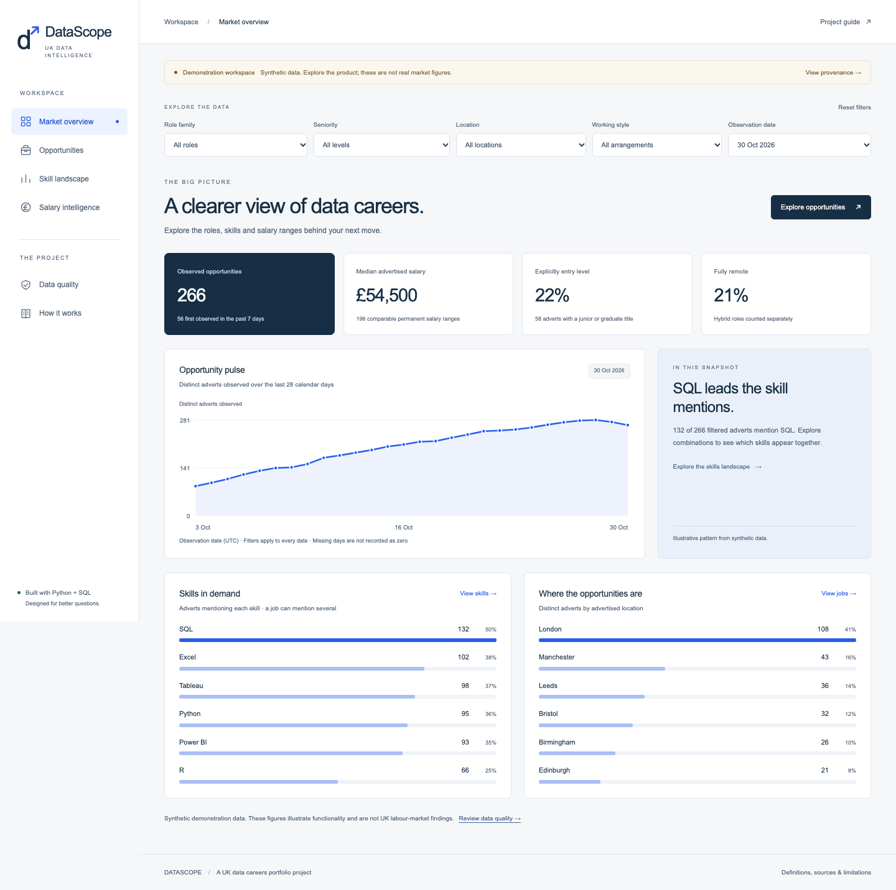
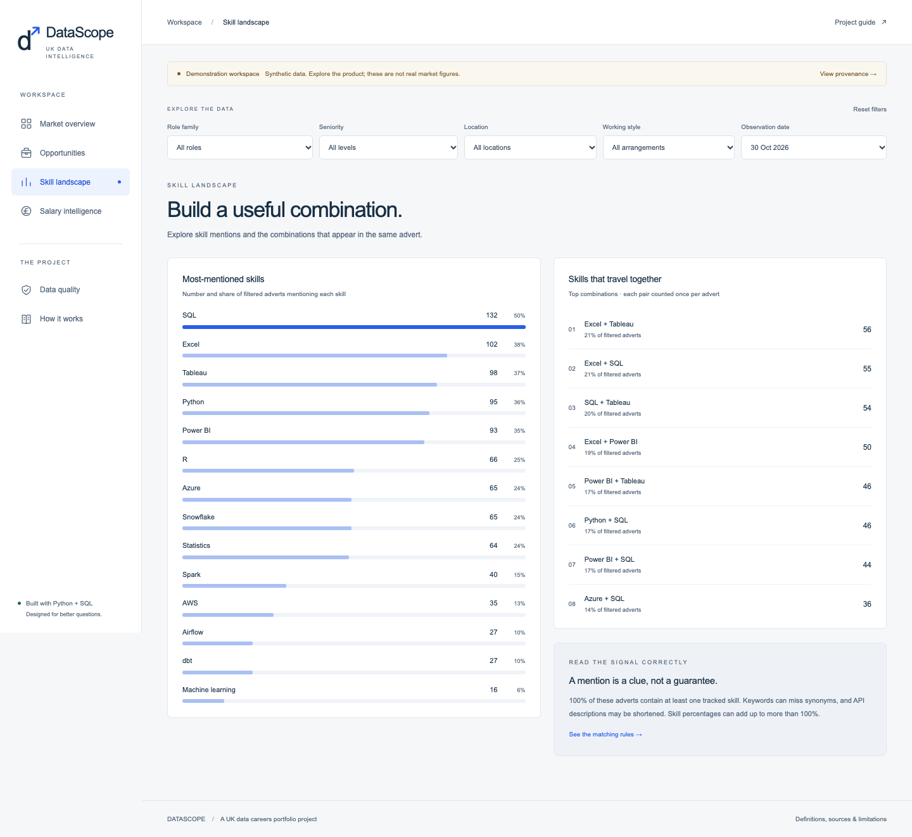
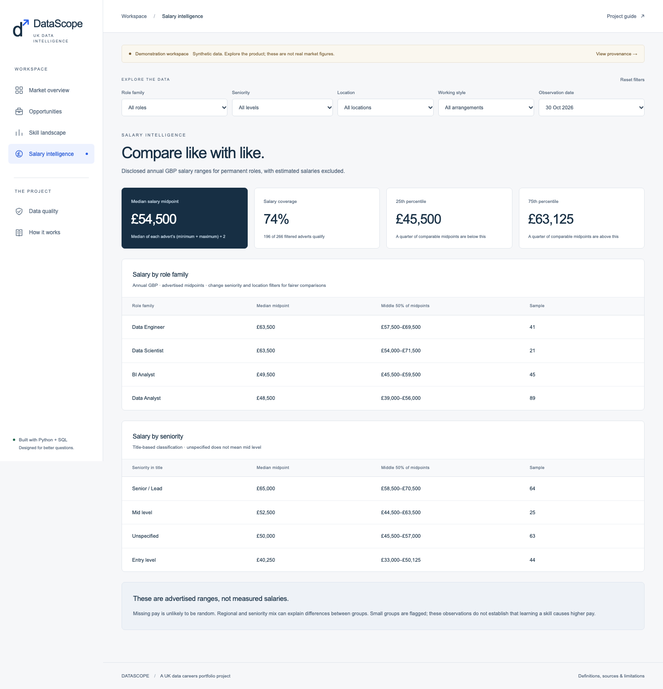
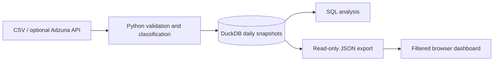

# DataScope — UK Data Jobs Intelligence

[](https://github.com/KhyzerRiaz24/datascope-uk-data-jobs/actions/workflows/checks.yml)

A data analytics portfolio project by **Khyzer Riaz**: collect job adverts, clean
and organise them with Python and SQL, then explore roles, skill requirements,
advertised salaries and working arrangements in a six-page dashboard.

**[Simple project explanation](docs/PROJECT_EXPLAINED.md)** ·
**[Follow the code](docs/WALKTHROUGH.md)** ·
**[Metric definitions](docs/METHODOLOGY.md)** ·
**[Checks completed](docs/VALIDATION.md)**

[Source repository](https://github.com/KhyzerRiaz24/datascope-uk-data-jobs) ·
[Automated checks](https://github.com/KhyzerRiaz24/datascope-uk-data-jobs/actions/workflows/checks.yml)



**The shipped dashboard uses synthetic demonstration data.** It is functional,
but its figures are not real UK job-market findings. Every page keeps that
distinction visible. Import your own permitted CSV data or configure the optional
Adzuna adapter to analyse a real sample. Live collection needs your own credentials.

## The question behind the project

Someone preparing for a data career might ask: which roles can I target, which
skills appear together, and what salary ranges are advertised for comparable
jobs? DataScope provides a repeatable way to explore those questions in a collected
dataset, while making the dataset's source and limitations visible.

The current demonstration shows the complete workflow, not empirical answers
about today's UK job market. No trained AI model or live collection is claimed.

## Start here

You need Python 3.11 or newer. Node 22.12+ is needed only for JavaScript tests.
Run commands from this project folder.

```sh
python3 -m venv .venv
.venv/bin/python -m pip install -r requirements.txt
PYTHONPATH=src .venv/bin/python -m ukjobs.cli demo
.venv/bin/python -m http.server 8765 --bind 127.0.0.1 --directory web
```

Open **http://127.0.0.1:8765** in your browser. Keep the server terminal open.
Stop it with Control+C. On Windows, activate your virtual environment, use
`python` instead of `.venv/bin/python`, and set `PYTHONPATH` to `src` in your shell.

If you only want to view the included demonstration, no Python packages are
needed: the last command serves the already generated `web/data.json`.

## What you can explore

- **Market overview:** observed adverts, comparable salaries, entry-level share,
  working arrangements and a 28-calendar-day trend.
- **Opportunities:** search, sorting, pagination and a CSV export of all matches.
- **Skill landscape:** skill mentions and pairs, counted once per advert.
- **Salary intelligence:** comparable annual GBP ranges, medians, quartiles and
  small-sample flags.
- **Data quality:** provenance, validation counts and pipeline history.
- **How it works:** the visible learning guide and connections between files.

All pages share role, seniority, location, working-style and observation-date
filters. Source comments at the start of every page explain its purpose and links.





## The data journey



Python prepares and stores the data. The browser reads the exported file and
recalculates views when filters change. It does not run Python or contact Adzuna.
This keeps the public demonstration independent of a running backend service.

## Follow the code

```text
CSV / synthetic fixture / optional Adzuna API
                  |
          src/ukjobs/cli.py        chooses the data source
                  |
          normalize.py            validates and classifies records
                  |
          storage.py              saves daily snapshots in DuckDB
                  |                  |
                  |              sql/analysis.sql
                  |              scripts/query.py
                  |
          web/data.json           read-only dashboard export
                  |
          web/app.js              owns shared filters and navigation
                  |
          web/analytics.js        shared tested calculations
                  |
          web/pages/*.js          six commented page modules
                  |
          web/ui.js + styles.css  shared components and visual layout
```

Read **[docs/WALKTHROUGH.md](docs/WALKTHROUGH.md)** for the beginner-friendly tour,
**[docs/METHODOLOGY.md](docs/METHODOLOGY.md)** for metric definitions and
**[docs/DATA_SOURCES.md](docs/DATA_SOURCES.md)** for real-data setup.

## Work with SQL

```sh
.venv/bin/python scripts/query.py --db data/demo.duckdb
```

This executes the four reports in `sql/analysis.sql`. You can also query the
`job_observations` view in a DuckDB client. Sample analyses cover role demand,
entry-level share by location, skill mentions and daily observed volumes.

## Import your own CSV

Use the schema documented in `docs/DATA_SOURCES.md`. The supplied example CSV
contains three fictional records purely for learning the import process.

```sh
PYTHONPATH=src .venv/bin/python -m ukjobs.cli import-csv \
  --csv data/example.csv --observed 2026-10-30 \
  --db data/example.duckdb --output web/data.json
```

Refresh the browser after the import. To return to the full demonstration:

```sh
PYTHONPATH=src .venv/bin/python -m ukjobs.cli demo
```

Demo, CSV and Adzuna databases cannot be mixed. This stops sample records from
silently contaminating a real-data portfolio analysis.

## Verify the project

```sh
PYTHONPATH=src .venv/bin/python -m unittest discover -s tests -v
npm test
npm run check
```

Browser checks require the optional development package and a Chromium browser:

```sh
npm ci
npx playwright install chromium
npm run test:browser
```

The browser suite starts its own local server on port 8766. It checks all pages,
shared filters, salary arithmetic, job search, CSV downloads, historical dates,
empty results, small screens and runtime errors. Screenshot output goes to
`test-results/` and is ignored by Git.

## Refreshing and hosting

The included optional `refresh.yml` workflow supports manual collection. Daily
collection stays disabled until you add repository secrets and set
`ENABLE_DAILY_REFRESH=true`. It saves the database and dashboard JSON as GitHub
artifacts. Those artifacts expire after 30 days: keep independent backups.
It does **not** automatically publish an updated website.

For a public recruiter-facing demo, the checks workflow also includes an opt-in
GitHub Pages deployment that runs only after checks pass on `main`. It stays off
until Pages is configured and `ENABLE_GITHUB_PAGES=true` is set. Follow the
[GitHub publishing guide](docs/GITHUB_PUBLISHING.md); a workflow file alone does
not mean that a GitHub repository or public website has already been published.

The `web/` folder is a complete static site. It can be served locally. Run
`python3 scripts/package_web.py` to copy it into the supported `dist/` hosting
directory declared in `.openai/hosting.json`. Publishing serves only that
copy; the Python pipeline runs locally or in GitHub Actions. Never put keys,
private source data or personal information in `web/`, because its files are
downloadable by anyone with access to the deployed dashboard.

## What this demonstrates on a CV

Python data processing, SQL aggregation, database modelling, data-quality checks,
reproducible analysis, browser visualisation and automated tests. It deliberately
does not claim a trained AI model, causal findings, hiring outcomes or whole-market
coverage. Before putting impact numbers on your CV, collect permitted real data,
run your own analysis and report only results you can reproduce and explain.

For a copy-ready LinkedIn draft, project entry and screenshot order, see
[LinkedIn material](docs/LINKEDIN.md). For a short demonstration, CV wording and
interview questions, see [portfolio notes](docs/PORTFOLIO.md).

## Credits and licence

Inspired by [Job Market Pulse](https://github.com/evgeniimatveev/job-market-pulse),
listed as project #211 in
[this AI/ML project directory](https://github.com/darkdevil3610/100-AI-Machine-learning-Deep-learning-Computer-vision-NLP).
The implementation, comments, documentation and synthetic dataset were written
independently. No upstream application code or credentials were copied.

Development used AI assistance. The documentation, explicit rules and retained
tests make the implementation available to inspect, reproduce and explain.

Code in this project is MIT licensed; see `LICENSE`. Source datasets and external
APIs retain their own access and reuse conditions. Adzuna's official contract is
documented at https://developer.adzuna.com/docs/search.
